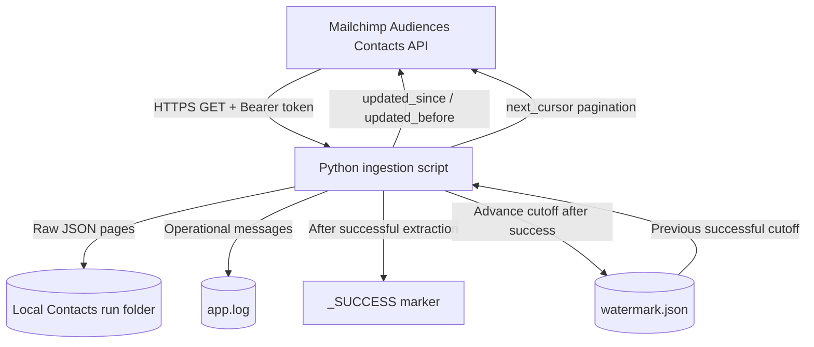
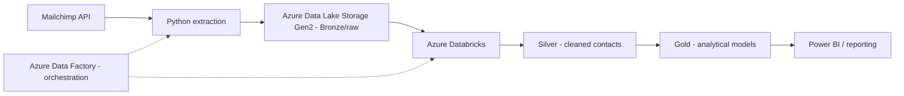

# Mailchimp API Ingestion | Incremental ELT Data Pipeline


A Python-based, **incremental API ingestion pipeline** that extracts contact data from the Mailchimp Audiences Contacts API and lands untransformed JSON files. The project demonstrates practical foundations for **Extract, Load, Transform (ELT)** workflows: authenticated API requests, cursor pagination, transient-failure retries, extraction logs, time-window watermarks, and a completion marker for downstream processing.

> **Current scope:** The Python-to-local-JSON extraction layer is implemented. Azure Data Lake Storage, Azure Data Factory orchestration, Databricks transformations, and analytics serving are proposed next steps.
## Table of contents

- [Project objectives](#project-objectives)
- [Architecture](#architecture)
- [Technology stack](#technology-stack)
- [How the pipeline works](#how-the-pipeline-works)
- [Incremental extraction and watermarks](#incremental-extraction-and-watermarks)
- [Pagination and resilience](#pagination-and-resilience)
- [Raw landing zone and completion marker](#raw-landing-zone-and-completion-marker)
- [Repository layout](#repository-layout)
- [Local setup](#local-setup)


## Project objectives

The goal is to move beyond a one-off API request and build an ingestion workflow that can be run repeatedly with a clear record of what was extracted.

1. **Extract** contact data from a REST API with credentials loaded from environment variables.
2. **Paginate** through potentially large audiences using the API's `next_cursor` response value.
3. **Recover** from temporary network and server errors using bounded retries and request timeouts.
4. **Land raw data** as separate JSON files, preserving the source contact objects for later ELT processing.
5. **Extract incrementally** by querying contacts updated within a persisted time window.
6. **Log operations** to make extraction progress and failures easier to diagnose.
7. **Signal completion** with a `_SUCCESS` file after the extraction loop completes.
8. **Prepare for cloud ELT**, where a storage layer and downstream compute engine can consume completed raw extracts.

## Architecture

### Implemented: local extraction



### Proposed: Azure ELT extension



The cloud diagram is a **target architecture**, not a claim that the Azure services are already connected.

## Technology stack

| Component | Technology | Purpose |
|---|---|---|
| Programming language | Python | Extraction logic and file operations |
| API client | `requests` | HTTP requests and response handling |
| Source system | Mailchimp Audiences Contacts API | Contact data source |
| Authentication | `python-dotenv` + environment variables | Load credentials without hardcoding them |
| Serialization | Python `json` | Persist source contacts as JSON |
| Watermark | Local `watermark.json` | Store the previous successful extraction cutoff |
| Observability | Python `logging` through `logs.py` | Record extraction progress and errors |
| Raw landing | Local filesystem | Store JSON page files |
| Version control | Git / GitHub | Track code and project documentation |

**Planned technologies:** Azure Data Lake Storage Gen2, Azure Data Factory, Azure Databricks/Delta Lake, and Power BI.

## How the pipeline works

### 1. Initialize the extraction window

At startup, the script reads the previous successful cutoff from `watermark.json` and captures the current UTC time as the upper bound of the new extraction window.

```python
with open("watermark.json", "r", encoding="utf-8") as file:
    watermark = json.load(file)

start_date = watermark["start_date"]
end_date = datetime.now(timezone.utc).isoformat(timespec="seconds")
```

The upper bound is calculated **once per run**, not once per page.

### 2. Build the API request

The request uses an audience ID and API key loaded from `.env`:

```python
load_dotenv()
api_key = os.getenv("MAILCHIMP_API_KEY")
audience_id = os.getenv("audience_id")

url = f"https://api.mailchimp.com/3.0/audiences/{audience_id}/contacts/"
headers = {"Authorization": f"Bearer {api_key}"}

params = {
    "count": 1000,
    "updated_since": start_date,
    "updated_before": end_date,
}
```

**Important:** `start_date` and `end_date` are Python variables. Do not surround them with quotes inside `params`; `'start_date'` would send the literal string instead of a valid datetime.

### 3. Retrieve all matching pages

The API response supplies a `contacts` collection and, when another page exists, a `next_cursor` value. The script writes the contacts from each page to a separate JSON file, then passes the cursor into the next request.

```python
contacts = data["contacts"]
next_page = data.get("next_cursor")

params["cursor"] = next_page
if next_page is None:
    break
```

Pagination and incremental filtering work together: the date parameters select the update window, while the cursor walks through all pages in that window.

### 4. Mark successful completion

After all pages have been extracted, the script creates an empty `_SUCCESS` file and updates `watermark.json` with the completed window's end time.

The intended operational rule is: **do not advance the watermark after a failed or incomplete extraction**.

## Incremental extraction and watermarks

A full extract downloads the audience repeatedly, even when few contacts have changed. An incremental extract requests only contacts whose update timestamps fall inside the desired window.

The Mailchimp filter definitions used in this project are:

| Parameter | Boundary | Interpretation |
|---|---|---|
| `updated_since` | Exclusive (`>`) | Updated after the previous cutoff |
| `updated_before` | Inclusive (`<=`) | Updated at or before the current cutoff |

Conceptually:

```sql
WHERE last_updated_at > previous_successful_cutoff
  AND last_updated_at <= current_run_cutoff
```

### Example

**Run 1**

- Previous watermark: `1990-01-01T00:00:00+00:00`
- New cutoff: `2026-10-22T17:45:45+00:00`
- Extract all matching contacts and complete all pages.
- Save `2026-10-22T17:45:45+00:00` only after success.

**Run 2**

- Previous watermark: `2026-10-22T17:45:45+00:00`
- New cutoff: the UTC timestamp captured at the start of Run 2.
- Extract contacts changed during the new interval.
- Save the new cutoff only after success.


## Repository layout

The layout below reflects the main script and supporting files; adjust the entry-point filename if yours differs.

```text
mailchimp-api-ingestion/
├── main.py                 # API extraction and watermark logic
├── logs.py                 # Logging configuration
├── requirements.txt        # Python dependencies
├── watermark.example.json  # Safe sample watermark for new users
├── .gitignore
├── README.md
├── .env                    # Local credentials; not committed
├── watermark.json          # Local extraction state; not committed
├── app.log                 # Local log file; not committed
└── Contacts/               # Extracted contact data; not committed
```

## Local setup

### Prerequisites

- Python 3.x and Git.
- Access to the relevant Mailchimp audience and its API credentials.
- A valid audience ID for the Audiences Contacts endpoint.

### 1. Clone the repository

```bash
git clone https://github.com/Fideladdi/mailchimp-api-ingestion.git
cd mailchimp-api-ingestion
```

### 2. Create a virtual environment

Windows PowerShell:

```powershell
python -m venv .venv
.\.venv\Scripts\Activate.ps1
```

### 3. Install dependencies

If `requirements.txt` is present:

```bash
pip install -r requirements.txt
```

At minimum, the external packages used by the extraction script are:

```bash
pip install requests python-dotenv
```

### 4. Configure credentials

Create `.env` in the project root:

```dotenv
MAILCHIMP_API_KEY=replace_with_your_api_key
audience_id=replace_with_your_audience_id
```

Never commit this file or paste real API keys into issues, screenshots, or documentation.

### 5. Initialize the watermark

Copy `watermark.example.json` to `watermark.json`, or create it using the sample from [First-run initialization](#first-run-initialization). The actual `watermark.json` is intentionally ignored by Git.

## Running the pipeline

From the project root, with the virtual environment active:

```bash
python main.py
```

If your entry point is named differently, run that filename instead.

A successful run should produce JSON page files under `Contacts/`, log extraction activity, create `_SUCCESS`, and advance `watermark.json`.
